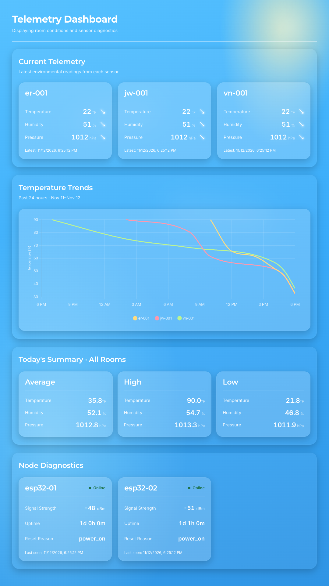
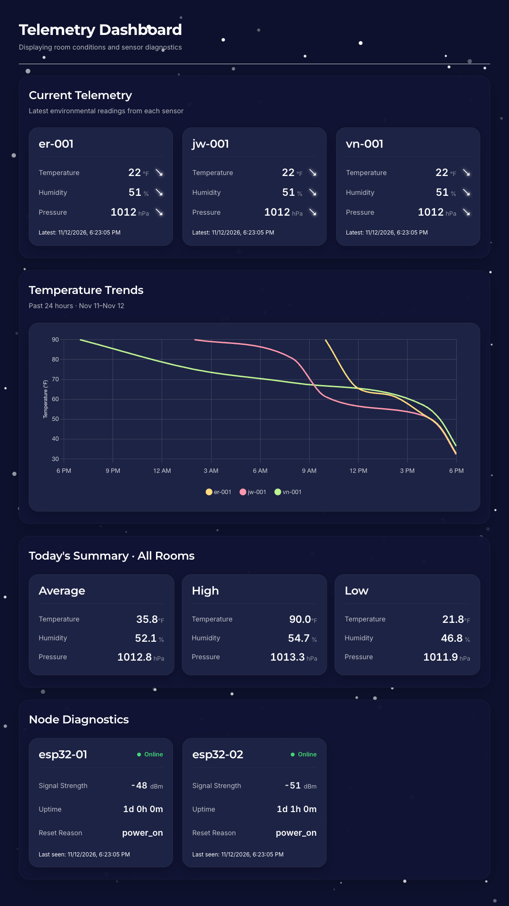
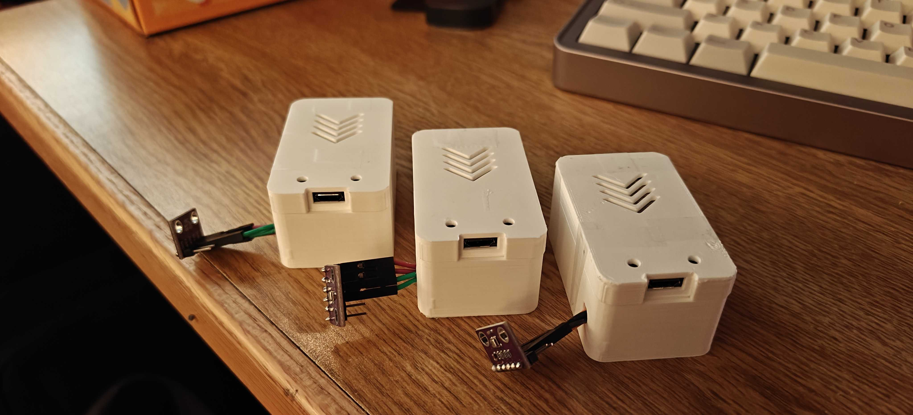

# BME Monitor

A full-stack IoT environmental monitoring platform designed to collect, process, store, and visualize environmental telemetry from distributed ESP32 nodes equipped with BME280 sensors.

This project demonstrates infrastructure design, CI/CD automation, and full-stack development through a telemetry collection system. It features a centralized React dashboard for monitoring temperature, humidity, atmospheric pressure, historical trends, and sensor health, supported by a containerized backend infrastructure.

## Features

- **Environmental Monitoring:** Collects temperature, humidity, and atmospheric pressure measurements from BME280 sensors.
- **Real-Time Dashboard:** Displays the latest environmental readings from multiple sensor nodes.
- **Historical Telemetry:** Visualizes environmental trends.
- **Device Diagnostics:** Tracks sensor availability, uptime, and last communication timestamps.
- **Telemetry Summaries:** Provides aggregated environmental statistics.
- **Automatic Updates:** Periodically refreshes dashboard data without requiring manual interaction.

## Technology Stack

| Category       | Technologies                            |
| -------------- | --------------------------------------- |
| Frontend       | React, JavaScript, Vite, TanStack Query |
| Backend        | Python, FastAPI, PostgreSQL             |
| Reverse Proxy  | NGINX                                   |
| Infrastructure | Docker, Docker Compose                  |
| Networking     | Tailscale                               |
| CI/CD          | GitHub Actions                          |
| Sensor         | Bosch BME280 Environmental Sensor       |
| Controller     | ESP32                                   |

## System Architecture

The application follows a distributed architecture that separates sensor data collection, backend processing, and visualization.

**High-Level Data Flow**

```text
BME280 Environmental Sensors
            |
            | I2C
            v
     ESP32 Sensor Nodes
            |
            | HTTP / Wi-Fi
            v
    Wireless Access Point
            |
            v
        Raspberry Pi
            |
            | (NGINX Proxy) HTTP
            v
      Remote Server
            |
            v
    Telemetry Ingestion API
            |
            v
      Telemetry Database
            |
            v
      FastAPI Data Server
            |
            v
     NGINX Reverse Proxy
            |
            v
       React Dashboard
```

The architecture separates data acquisition from frontend presentation, allowing multiple sensor nodes to be monitored through a centralized interface.

## Dashboard Preview

The frontend provides a centralized interface for viewing current environmental conditions, historical telemetry, and device diagnostics.

### Daytime View


### Nighttime View


The dashboard includes:

- Current environmental telemetry cards
- Historical environmental trend graphs
- Aggregated telemetry summaries
- Individual sensor node diagnostic cards

## Technical Implementation

### Sensor Telemetry

Environmental measurements are collected using Bosch BME280 sensors connected to ESP32 microcontrollers utilizing the I2C communication protocol.

Each ESP32 node collects temperature, humidity, and atmospheric pressure readings before transmitting telemetry to the backend ingestion service over HTTP through a dedicated wireless network.

Each measurement is associated with a unique device identifier, allowing the backend to distinguish between individual sensor nodes and maintain historical telemetry records.



### Backend Services

The backend is implemented using Python and FastAPI, with separate services responsible for telemetry ingestion, database operations, and data retrieval.

Incoming environmental measurements are processed and stored in a PostgreSQL database, maintaining historical telemetry records associated with individual sensor nodes.

The data retrieval service exposes REST API endpoints for retrieving current readings, historical trends, aggregated statistics, and device diagnostics.

Separating backend responsibilities into individual services improves maintainability and allows components to evolve independently.

More documentation on services can be located in their respective `docs/` in this repository.

### Frontend Dashboard

The monitoring dashboard is developed using React and Vite, providing a responsive interface for visualizing environmental telemetry and device diagnostics.

TanStack Query is used to manage asynchronous API requests, caching, and automatic data polling. This allows the dashboard to periodically retrieve updated sensor measurements without requiring manual page refreshes.

The frontend is served through NGINX, which also acts as a reverse proxy to route API requests to the appropriate backend service.

## Deployment & Infrastructure

The application is deployed on a self-hosted Ubuntu server using Docker Compose for container orchestration.

Tailscale provides private network connectivity, while NGINX handles static frontend hosting and reverse proxying between the dashboard and backend services.

The deployment architecture includes:

- **Docker:** Containerization of application components
- **Docker Compose:** Multi-container service orchestration
- **NGINX:** Static frontend hosting and API reverse proxying
- **Tailscale:** Private network access to application services
- **GitHub Actions:** Automated testing, image building, and deployment
- **GitHub Container Registry:** Storage and distribution of container images

### Continuous Deployment

The project uses GitHub Actions to automate testing, container image builds, and deployment.

When changes are pushed to the main branch, automated tests are executed using pytest. If all tests pass, the application container images are built and published to GitHub Container Registry (GHCR).

A self-hosted GitHub Actions runner deployed on the Ubuntu server then retrieves the updated container images and deploys the services using Docker Compose.

This pipeline automates the process of validating and deploying application changes while reducing manual intervention and improving deployment consistency.

## Engineering Challenges

### Designing Sensor-to-Server Communication

One of the primary challenges during development was designing a reliable communication pipeline between the distributed ESP32 sensor nodes and the remote telemetry ingestion server.

I chose HTTP over Wi-Fi as the communication method because of its simplicity, compatibility with ESP32 microcontrollers, and ease of integration with the FastAPI backend.

To establish network connectivity, I configured a dedicated wireless access point to connect the ESP32 sensor nodes to a Raspberry Pi. The Raspberry Pi runs an NGINX reverse proxy that forwards incoming telemetry requests to a remotely hosted backend server.

This architecture separates the local sensor network from the remote application infrastructure while providing a centralized entry point for telemetry transmission.

### Building Reliable Infrastructure and Deployment Pipelines

Another major challenge was designing an infrastructure capable of consistently collecting and processing telemetry while remaining maintainable as the project evolved.

Although the system is still being improved, I implemented several practices to increase deployment reliability and reduce operational overhead.

One of the most impactful improvements was introducing a CI/CD pipeline using GitHub Actions. The pipeline automates application deployment and incorporates unit testing to validate changes before deployment.

By requiring changes to pass automated tests, the deployment process reduces the risk of introducing regressions and minimizes manual intervention.

Containerizing the application with Docker and managing services through Docker Compose further simplified deployment by providing consistent application environments.

These improvements have made the system easier to maintain and have helped establish a more reliable foundation for future development.

## Future Improvements

- Implementation of Kubernetes on production environment for container orchestration
- Improve device error handling and diagnostics
- Add configurable alerts for environmental thresholds
- Expand telemetry analytics and visualization
- Improve monitoring and observability across backend services
